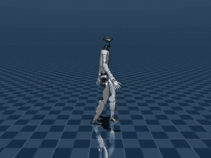
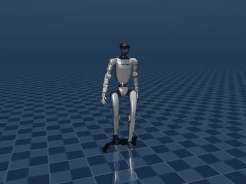
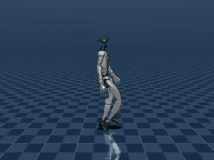
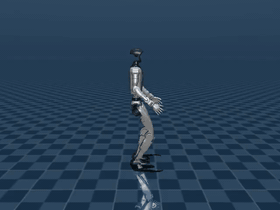
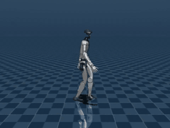
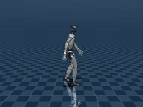
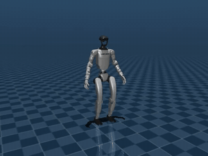
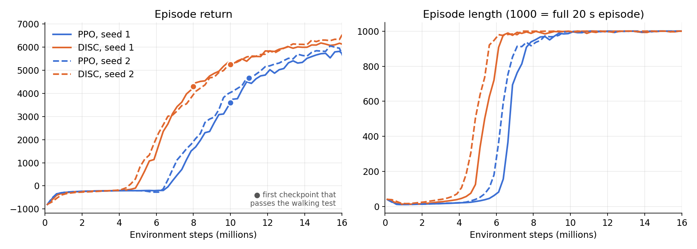
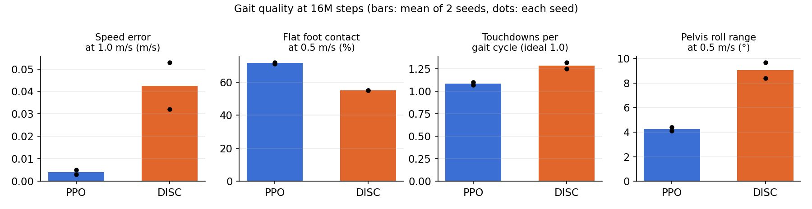

# Learning Humanoid Walking for the Unitree G1 in MuJoCo

<p align="center">
  
  
  
</p>
<p align="center"><sub>One learned policy, commanded at 0.5 m/s (side and front) and 1.0 m/s. 23 joints controlled at 50 Hz in standard CPU MuJoCo.</sub></p>

Reinforcement learning for the **Unitree G1** humanoid, built from scratch on a laptop (Apple M2, CPU MuJoCo, Stable-Baselines3). The repo contains:

1. **A velocity-tracking walking benchmark (v1)** with a human-like gait: alternating steps on a gait clock, bent knees, flat-footed landings, symmetric leg paths, and arms swinging opposite the legs. A from-scratch PPO baseline reproduces the gait across seeds, with **0 falls** in the benchmark evaluation.
2. **A PPO vs DISC study** of sample efficiency on that benchmark, including a reimplementation of DISC (Han & Sung, ICML 2019) checked against SB3.

All code, checkpoints and the full write-up are in [`flat_walking_v1/`](flat_walking_v1/).

---

## 1. Walking benchmark (v1)

### From falling to walking

<p align="center">
  
  
  
</p>
<p align="center"><sub>The same PPO run at 4M, 7M and 10M environment steps (0.5 m/s command).</sub></p>

### Environment design

- **Control:** PD position targets around a bent-knee default pose, for 12 leg joints, 3 waist joints and 4 joints per arm, at 50 Hz. Menagerie's straight-legged keyframe let policies lock their knees, so the env builds its own default pose. The arms use soft gains so they swing like pendulums.
- **Commands:** forward speed from 0 to 1.2 m/s, with 30% of episodes standing still.
- **Gait clock:** the step period adapts to speed (1.1 s slow, 0.8 s fast), and the left and right legs run in antiphase.
- **Observations (96):** base velocity and orientation, command, heading error, gait phase, all joint positions and velocities, previous action.
- **Rewards** in seven groups: task (velocity, heading), gait (clock-aligned stance and swing, foot height, step length), feet (flat landings, no slip, landing width, no crossovers), posture, arm swing, standing still, and smoothness.
- **Mirror symmetry:** PPO tends to settle into lopsided gaits, and reward terms alone did not fix that. `SymmetricPPO` adds a left/right mirror loss on the policy. Its mirror maps were verified exactly against a physically mirrored simulator state.

### Results

Two seeds trained from scratch for 16M steps (≈1.5 h each on an M2 laptop). Both learn to walk by 7–8M steps and converge to the same gait. Each command was evaluated over 3 episodes of 20 s:

| Seed 1 / seed 2 | 0.5 m/s | 1.0 m/s |
|---|---|---|
| Falls | 0 / 6 episodes | 0 / 6 episodes |
| Speed tracking | 0.489 / 0.496 m/s | 0.998 / 1.005 m/s |
| Feet on the gait clock (phase match) | 99% | 97–98% |
| Step length vs target | 0.257 / 0.249 m (target 0.254) | 0.395 / 0.392 m (target 0.400) |
| Max heading error | 3–4° | 4–9° |
| Arm swing back / forward | 16–17° | 25–27° |



At 0 m/s the policy **stands still**, with both feet down 100% of the time and ≤ 2 mm drift.

Seed-by-seed numbers, the full metric set (touchdowns per cycle, slip, landing speed, foot roll, landing width, pelvis roll and more) and every reward term are in [`flat_walking_v1/README.md`](flat_walking_v1/README.md).

<br clear="right">

---

## 2. PPO vs DISC: sample efficiency

[DISC](https://proceedings.mlr.press/v97/han19b.html) clips the importance-sampling ratio per action dimension instead of over the whole action, and reuses recent rollouts. I reimplemented it on top of `SymmetricPPO`. On a single on-policy batch, its log-probs, values, advantages and targets match SB3's GAE to float precision.

With the paper's settings, DISC never learned to walk in 16M steps: the IS loss held every update to ~1% of PPO's step size. Tuning only DISC (J_targ 1e-4 → 1e-2, replaying 4 rollouts) fixed that. Seed 2 was held out from tuning.

<p align="center"></p>

| | PPO seed 1 | DISC seed 1 | PPO seed 2 | DISC seed 2 |
|---|---|---|---|---|
| First checkpoint that walks | 10M | **8M** | 11M | **10M** |
| Return at 8M steps | 1306 | **4055** | 1689 | **3682** |
| Return at 16M steps | 5811 | **6134** | 5977 | **6339** |
| Wall-clock, 16M steps | **3.6 h** | 4.9 h | **3.4 h** | 4.7 h |

**DISC walks 1–2M steps sooner, but its final gait is less polished.** At 16M steps all four policies have 0 falls, but DISC tracks speed less precisely, lands flat-footed less often and rolls its pelvis about twice as much. Its action noise collapses early (std ~0.05 vs ~0.11 for PPO), so it stops exploring sooner.

<p align="center"></p>

Two seeds per algorithm is a small sample, and runs are not bit-for-bit reproducible, so these are indications rather than conclusions.

---

## What's next

This work continues as a separate project on **stair ascent and descent** for the G1, comparing standard PPO with **TD-regularized PPO** (Parisi et al., 2019), which penalizes policy updates where the critic's Bellman (TD) error is large. Pretrained policies are then adapted online, first in simulation under controlled dynamics mismatch and later on the physical robot.

---

## Quick start

```bash
python3.11 -m venv .venv && source .venv/bin/activate
pip install -r flat_walking_v1/requirements.txt
git clone --depth 1 https://github.com/google-deepmind/mujoco_menagerie.git ../mujoco_menagerie

cd flat_walking_v1
# Render the trained policy (azimuth 90 = side view, 180 = front)
python render_video.py --model ../../mujoco_menagerie/unitree_g1/scene.xml \
    --policy checkpoints/g1_ppo_seed1_16M.zip --command 0.5 --azimuth 90
# Benchmark evaluation
python benchmark_eval.py --model ../../mujoco_menagerie/unitree_g1/scene.xml \
    --policies checkpoints/g1_ppo_seed1_16M.zip checkpoints/g1_ppo_seed2_16M.zip
# Train from scratch (~1.5 h on an M2 with 8 envs)
python train.py --model ../../mujoco_menagerie/unitree_g1/scene.xml --steps 16000000 --envs 8 --seed 1 --out runs_seed1
```

Built with [MuJoCo](https://mujoco.org), [MuJoCo Menagerie](https://github.com/google-deepmind/mujoco_menagerie) (Unitree G1 model), [Gymnasium](https://gymnasium.farama.org) and [Stable-Baselines3](https://stable-baselines3.readthedocs.io).
